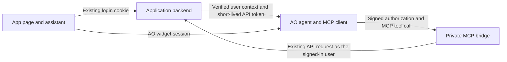

# How AO connects to an application

The application owns login and data permissions. AO runs the assistant and asks for approval before writes. The private MCP bridge turns approved tools into requests to the application's existing API.

## What happens when a user opens the assistant

1. The widget asks the application for access. The app checks its existing login, tenant, and assistant permission.
2. The app uses its server integration key to send AO the verified user context and the user's API token. AO checks the deployment, embedding origin, and tenant. The browser gets a separate AO widget token, valid for up to five minutes.
3. The agent can use only the published tools allowed for that session. AO sends a short-lived signed grant to the MCP bridge. The bridge calls the fixed HTTPS API with the user's token. The API makes the final decision on record access.
4. When a write is proposed, AO shows the exact action for approval. AO and the bridge each record a claim before dispatch so the same approval cannot send a second write. After an uncertain result, check the app before attempting a new action.

## Where the sensitive data goes

| Data                       | Where it belongs                                                                                                            |
| -------------------------- | --------------------------------------------------------------------------------------------------------------------------- |
| App API token              | Sent server-to-server. The bridge keeps it encrypted in Redis until expiry or revocation.                                   |
| AO widget token            | The browser keeps it in memory. AO stores its hash, session details, and a reference to the Redis credential in PostgreSQL. |
| Deployment integration key | The app backend keeps the key. AO stores its hash.                                                                          |
| MCP signing key            | AO keeps the private key. The bridge verifies signed grants with the public key.                                            |

One external tenant maps to one AO workspace. Widget conversations and approvals are scoped to the user's deployment and published agent version. Application routes still check the user, tenant, and record. Publishing or editing a draft does not change a live deployment until the owner updates it.

## Where setup can get simpler

- **Ship framework-ready files.** The Next.js kit now includes the route entry point and a separate connector module. The app developer supplies the login adapter. AO generates the route wiring and public settings.
- **Show where an installation failed.** A future deployment status could distinguish the first accepted host session from the first successful user-scoped read. Use only results from real sign-ins, show them to authorized workspace owners, and omit user IDs, tokens, and request payloads. Keep bridge validation separate because it cannot prove the host login works.
- **Revoke by host login instead of tracking each widget token.** A future server-only revocation endpoint could let an app revoke all widget sessions for one opaque login reference. Scope the reference to the verified deployment, tenant, and user. Preserve logout race protection and short expiry. The current connector still tracks and revokes tokens individually.

The app must supply its verified session and enforce record permissions. Keeping that boundary lets AO automate more of the setup without taking over application login.

[Install the connector](host-connectors.md) · [Run and troubleshoot the bridge](mcp-bridge.md) · [Maintain older deployments](legacy-deployments.md)
